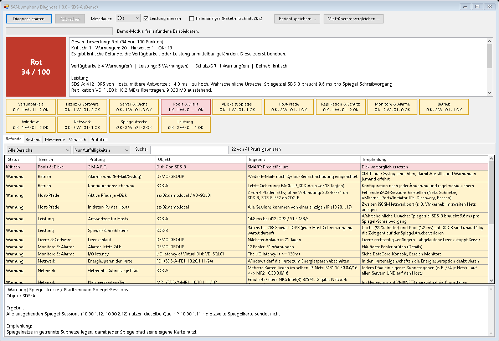
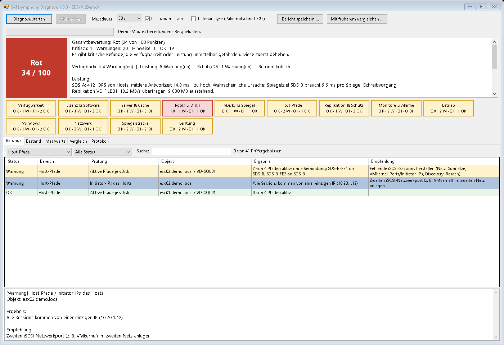
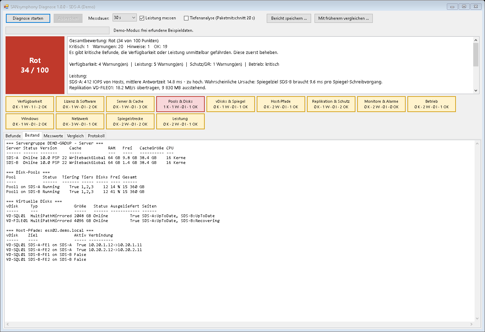
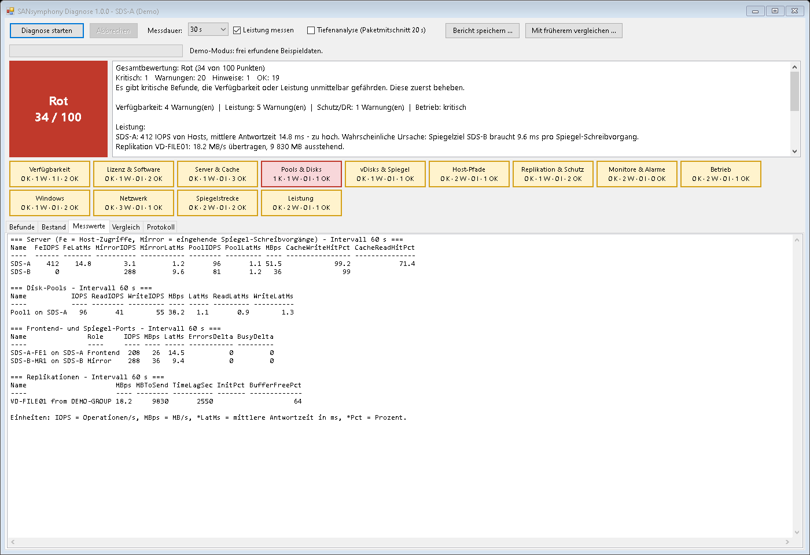
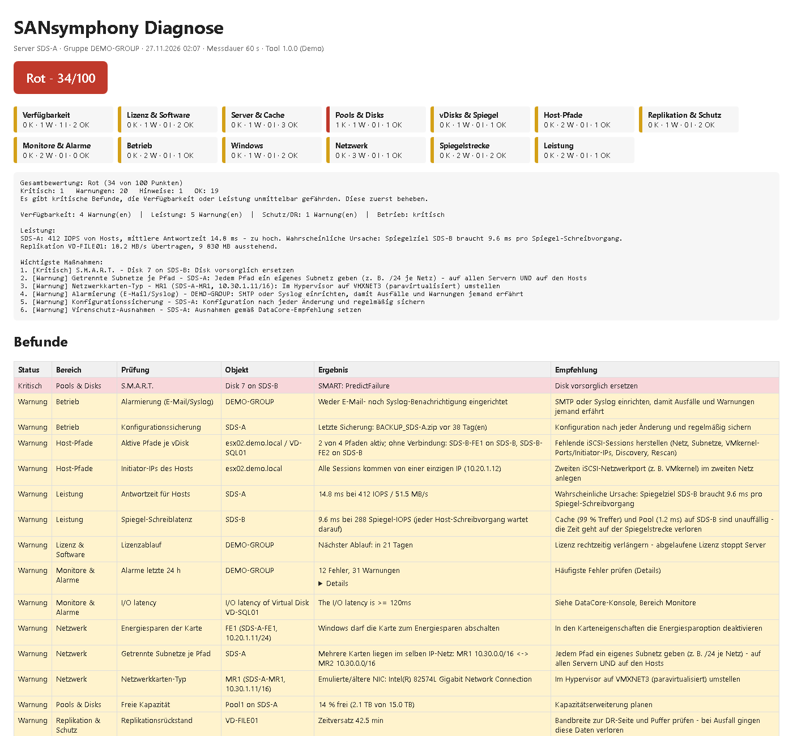

# SANsymphony Diagnose

**Health Check und Engpassanalyse für DataCore SANsymphony – ein Klick, rund 100 Prüfungen, eine klare Einschätzung.**

Für DataCore-Techniker (DCIE), Partner und Administratoren: Das Tool läuft direkt auf einem SANsymphony-Server, prüft die gesamte Servergruppe von der Lizenz bis zur Spiegelstrecke, misst die Leistung auf allen Ebenen und sagt, **was** auffällig ist, **warum** und **was zu tun ist**. Es ist rein lesend und ändert nichts.



> Alle Bilder zeigen den eingebauten **Demo-Modus** mit frei erfundenen Daten.

---

## Inhalt

- [Warum dieses Tool](#warum-dieses-tool)
- [Schnellstart](#schnellstart)
- [Was geprüft wird](#was-geprüft-wird)
- [Oberfläche](#oberfläche)
- [Bericht, Vergleich, Automatisierung](#bericht-vergleich-automatisierung)
- [Sicherheit und Datenschutz](#sicherheit-und-datenschutz)
- [Voraussetzungen](#voraussetzungen)
- [FAQ](#faq)
- [Mitmachen](#mitmachen)
- [English summary](#english-summary)

## Warum dieses Tool

Bei Einsätzen vor Ort kosten immer dieselben Fragen Zeit: Läuft der Cache im Write-Back? Hat jeder Host wirklich alle Pfade? Warum ist die Schreiblatenz hoch – Backend, Cache, Spiegel oder Netz? Liegen die Spiegelkarten sauber in getrennten Subnetzen? SANsymphony Diagnose beantwortet das in einem Durchlauf und zeigt die **Ursachenkette**, zum Beispiel:

> *SDS-A: 412 IOPS von Hosts, mittlere Antwortzeit 14,8 ms – zu hoch. Wahrscheinliche Ursache: Spiegelziel SDS-B braucht 9,6 ms pro Spiegel-Schreibvorgang. Cache (99 % Treffer) und Pool (1,2 ms) auf SDS-B sind unauffällig – die Zeit geht auf der Spiegelstrecke verloren.*

Die Prüfungen sind aus echten Einsätzen entstanden – etwa Spiegelkarten im selben Subnetz, über die Windows dann nur eine Karte nutzt, oder ESXi-Hosts, deren zweiter iSCSI-Pfad mit falscher Quell-IP anklopft.

## Schnellstart

1. Unter [**Releases**](../../releases/latest) die Datei `SsyDiagnose-1.0.0.zip` herunterladen.
2. Auf einen SANsymphony-Server kopieren und entpacken.
3. `Start-SsyDiagnose.cmd` doppelklicken (UAC-Abfrage bestätigen).
4. **Diagnose starten** – fertig. Für aussagekräftige Leistungswerte während typischer Last messen.

Ausprobieren ohne SANsymphony, z. B. für Schulungen:

```powershell
powershell -ExecutionPolicy Bypass -File .\SsyDiagnose.ps1 -Demo
```

## Was geprüft wird

Rund 100 Prüfergebnisse in 13 Bereichen, jeweils mit Status (Kritisch / Warnung / Hinweis / OK), Ergebnis und konkreter Empfehlung.

| Bereich | Prüfungen (Auszug) |
|---|---|
| **Verfügbarkeit** | Serverstatus, Wartungsmodus, Witness, nicht gespiegelte vDisks, Host erreicht beide Spiegelseiten |
| **Lizenz & Software** | Compliance, Lizenzablauf, Lizenz-Alarme, Kapazität, gleicher PSP-Stand auf allen Servern |
| **Server & Cache** | Write-Back-Cache, Stromversorgung/USV, freier RAM, Cache-Größe, Protokollierung |
| **Pools & Disks** | Pool-Status und -Modus, freie Kapazität, Überbuchung, Pool-Disk-Status, Tiers, S.M.A.R.T., ungenutzte Disks |
| **vDisks & Spiegel** | vDisk-Status, Write-Through, Zuordnung, Datenstand je Spiegelseite, Resync, Spiegelbeziehungen |
| **Host-Pfade** | aktive Pfade je Host und vDisk, Initiator-IPs (ein VMkernel-Port für alles?), Sessions über Kreuz, MPIO, ALUA |
| **Replikation & Schutz** | Status, Rückstand, Puffer und Pufferordner, Initialisierung, DR-Testmodus, Snapshots, CDP, Rollbacks |
| **Monitore & Alarme** | alle auffälligen DataCore-Monitore, häufigste Alarme der letzten 24 h, unbestätigte Alarme |
| **Betrieb** | Konfiguration synchron, Uhrzeit der Server, Alter der Konfigurationssicherung, E-Mail/Syslog-Alarmierung |
| **Windows** | Dienste, Energiesparplan, CPU inkl. Poller-Reservierung, Patchstand, Ereignisprotokoll (Speicher/Netz), Virenschutz-Ausnahmen, Firewall |
| **Netzwerk** | NIC-Typ (E1000 vs. VMXNET3), getrennte Subnetze je Pfad, MTU, Delayed ACK, Energiesparen der Karte, RSS, Gateway/DNS auf iSCSI-Karten, Port 3793 zu Partnern |
| **Spiegelstrecke** | Sessions im passenden Subnetz, Pfadtrennung, Laufzeit, Paketverlust, MTU Ende-zu-Ende, iSCSI-Digest, optional **Tiefenanalyse** per Paketmitschnitt |
| **Leistung** | Host-Antwortzeit mit Ursachenkette, Spiegel-, Pool- und Disk-Latenz, Warteschlangen, Cache-Treffer, Pool-Asymmetrie, Port-Fehler, Replikationsdurchsatz |

Die vollständige Liste steht in [`src/LIESMICH.txt`](src/LIESMICH.txt).

## Oberfläche

| | |
|---|---|
|  |  |
| **Befunde** filtern nach Bereich, Status oder Suchbegriff; die Detailansicht zeigt Ergebnis, Empfehlung und Hintergrund. | **Bestand**: Server, Pools, Disks, vDisks, Hosts mit allen Pfaden, Replikationen, iSCSI-Karten und Sessions. |
|  |  |
| **Messwerte**: IOPS, MB/s und Latenz für Server, Spiegel, Pools, Disks, Ports und Replikation. | **HTML-Bericht** zum Weitergeben an Kunden oder Support – [Beispiel ansehen](docs/beispielbericht-demo.html). |

Weitere Funktionen: Ampel mit Punktzahl, Kacheln je Bereich (Klick filtert), Gesamteinschätzung für Verfügbarkeit / Leistung / Schutz / Betrieb, Abbrechen jederzeit, Live-Protokoll.

## Bericht, Vergleich, Automatisierung

- **Speichern** als HTML (Kundenbericht), JSON (für spätere Vergleiche) oder CSV.
- **Vergleich**: früheren JSON-Bericht laden → was ist neu, behoben, schlechter; Leistung vorher/nachher. Ideal für „vor und nach der Änderung“.
- **Ohne Oberfläche**, z. B. als geplante Aufgabe:

```powershell
.\SsyDiagnose.ps1 -NoGui -Seconds 60 -ReportPath C:\Temp\bericht.html -JsonPath C:\Temp\bericht.json
.\SsyDiagnose.ps1 -NoGui -CompareWith C:\Temp\vorher.json -DeepAnalysis
```

| Schalter | Bedeutung |
|---|---|
| `-NoGui` | Konsolenausgabe statt Fenster |
| `-Seconds n` | Messdauer (10–600 s, Standard 30) |
| `-SkipPerformance` | nur Konfiguration prüfen, keine Leistungsmessung |
| `-DeepAnalysis` | 20 s Paketmitschnitt der iSCSI-Anmeldungen (pktmon) |
| `-ReportPath` / `-JsonPath` | Bericht als HTML / JSON speichern |
| `-CompareWith datei.json` | mit früherem Lauf vergleichen |
| `-Demo` | Beispieldaten, kein SANsymphony nötig |

## Sicherheit und Datenschutz

- **Rein lesend.** Das Tool nutzt ausschließlich `Get-*`-Cmdlets von DataCore und lesende Windows-Abfragen. Es ändert keine Konfiguration.
- **Keine Daten verlassen den Server.** Keine Telemetrie, keine Internetverbindung, keine Uploads. Berichte landen nur dort, wo Sie sie speichern.
- **Tiefenanalyse** (optional) startet `pktmon` nur, wenn kein anderer Mitschnitt und keine pktmon-Filter aktiv sind, und räumt danach auf.
- **Ping-/MTU-Tests** senden einige ICMP-Pakete zwischen den eigenen Spiegel-IPs.
- Berichte enthalten Servernamen, IP-Adressen und Konfiguration – behandeln Sie sie wie Kundendaten.

## Voraussetzungen

- SANsymphony 10.0 mit installierten DataCore-PowerShell-Cmdlets (getestet mit 10.0 PSP 22)
- Windows Server 2016 oder neuer, Windows PowerShell 5.1
- Administratorrechte auf dem SANsymphony-Server
- Tiefenanalyse: `pktmon` (ab Windows Server 2019)

Netzwerk-, Windows- und Session-Prüfungen gelten für den Server, auf dem das Tool läuft. Für ein vollständiges Bild das Tool auf jedem Server der Gruppe ausführen.

## FAQ

**Warum steht da „Zu wenig Host-Last“?** Antwortzeiten unter 5 IOPS sind statistisch wertlos. Während typischer Last messen oder Last erzeugen (z. B. `diskspd`/`fio` in einer VM).

**Windows meldet „Ausführung von Skripts ist deaktiviert“.** `Start-SsyDiagnose.cmd` verwenden – es startet mit `-ExecutionPolicy Bypass`. Heruntergeladene Dateien ggf. mit `Unblock-File` freigeben.

**Funktioniert das auch für Hyper-converged / VM-basierte Installationen?** Ja. Bei virtuellen SANsymphony-Servern prüft das Tool zusätzlich NIC-Typ (VMXNET3) und weist auf Reservierungen hin.

**Wie werden Punkte vergeben?** Abzug je *Art* von Befund (nicht je Objekt): kritisch −20 (max. −60), Warnung −3 (max. −45), Hinweis −1 (max. −5). Ampel: Rot bei kritischem Befund, Gelb bei Warnungen, sonst Grün.

## Mitmachen

Fehlerberichte, Vorschläge für neue Prüfungen und Erfahrungen aus Einsätzen bitte als [**Issue**](../../issues/new/choose) einreichen – dafür gibt es Vorlagen. **Pull Requests werden nicht angenommen**; gute Vorschläge fließen über die Issues in die nächste Version ein. Details in [CONTRIBUTING.md](CONTRIBUTING.md). Bitte **keine Kundendaten** posten; der Demo-Modus eignet sich für Beispiele.

## Haftungsausschluss

Community-Projekt, **kein offizielles Produkt der DataCore Software Corporation** und nicht von DataCore unterstützt oder geprüft. DataCore und SANsymphony sind Marken der DataCore Software Corporation. Nutzung auf eigene Verantwortung; die Empfehlungen ersetzen nicht die offiziellen DataCore Best Practices.

## Lizenz

[MIT](LICENSE)

---

## English summary

**SANsymphony Diagnose** is a read-only health check and bottleneck analyzer for DataCore SANsymphony, aimed at DataCore engineers (DCIE), partners and admins. Run it on a SANsymphony server: it checks ~100 items across 13 areas (availability, licensing, cache, pools, vDisks and mirrors, host paths, replication, alerts, operations, Windows, networking, mirror links, performance), measures latency on every layer and explains the likely root cause. Results can be saved as HTML/JSON/CSV and compared over time. No data leaves the server. The UI and reports are currently in German; contributions for an English UI are welcome. Try it without SANsymphony: `.\SsyDiagnose.ps1 -Demo`.
