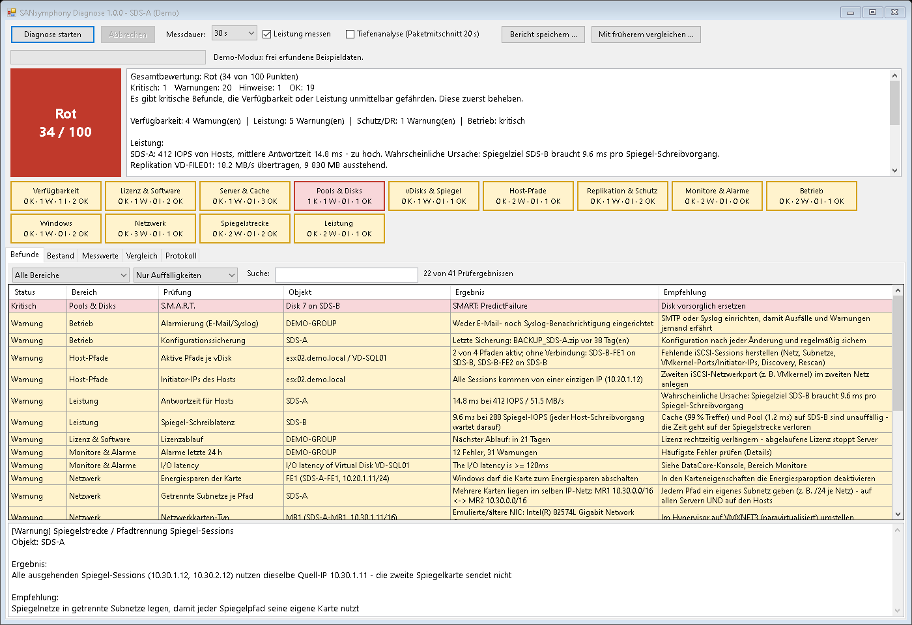

## SANsymphony Diagnose 1.0.0

Erste öffentliche Version des Health Checks für DataCore SANsymphony – für DCIE-Techniker, Partner und Administratoren.

### Highlights
- **Rund 100 Prüfungen in 13 Bereichen** – von Lizenz und Cache über Host-Pfade und Replikation bis zur Spiegelstrecke
- **Leistungsmessung mit Ursachenkette**: Host-Latenz → Spiegel → Cache → Backend → Netz
- **Host-Pfad-Analyse** je vDisk, inkl. Hosts mit nur einem iSCSI-Port
- **Spiegelstrecke**: Subnetz-Trennung, Pfadtrennung, Ping, Paketverlust, MTU Ende-zu-Ende
- **Tiefenanalyse** (optional, `pktmon`): findet Initiatoren mit falscher Quell-IP
- **Berichte** als HTML/JSON/CSV und **Vergleich** mit früheren Läufen
- **Demo-Modus** für Schulungen: `SsyDiagnose.ps1 -Demo`
- **Rein lesend**, keine Telemetrie, keine Internetverbindung

### Installation
1. `SsyDiagnose-1.0.0.zip` herunterladen und auf einem SANsymphony-Server entpacken
2. `Start-SsyDiagnose.cmd` doppelklicken
3. **Diagnose starten**

Voraussetzungen: SANsymphony 10.0 mit DataCore-PowerShell-Cmdlets (getestet mit PSP 22), Windows PowerShell 5.1, Administratorrechte.

Prüfsumme: siehe `SsyDiagnose-1.0.0.zip.sha256`.

*Community-Projekt, kein offizielles Produkt der DataCore Software Corporation.*

